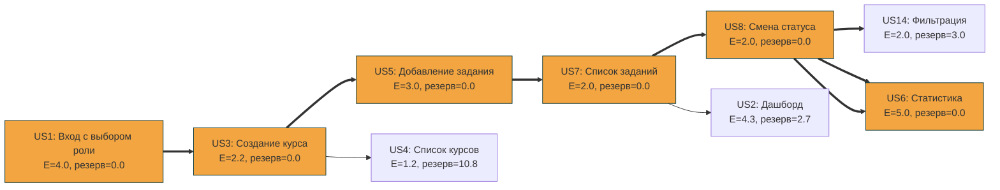

# План релиза MVP

## Сетевой график и критический путь (PERT/CPM)

Для построения сетевого графика и поиска критического пути использовался официальный скрипт `pert_cpm.py` и данные из `scripts/tasks.csv` (трёхточечные оценки O, M, P в часах).

**Результаты расчёта:**

| ID | E (ч) | σ (ч) | ES | EF | LS | LF | Резерв | Задача |
|---|---|---|---|---|---|---|---|---|
| US1 | 4.00 | 0.67 | 0.00 | 4.00 | 0.00 | 4.00 | 0.00 | Вход с выбором роли * |
| US3 | 2.17 | 0.50 | 4.00 | 6.17 | 4.00 | 6.17 | 0.00 | Создание курса * |
| US5 | 3.00 | 0.67 | 6.17 | 9.17 | 6.17 | 9.17 | 0.00 | Добавление задания * |
| US7 | 2.00 | 0.33 | 9.17 | 11.17 | 9.17 | 11.17 | 0.00 | Список заданий (студент) * |
| US8 | 2.00 | 0.33 | 11.17 | 13.17 | 11.17 | 13.17 | 0.00 | Смена статуса * |
| US14 | 2.00 | 0.33 | 13.17 | 15.17 | 16.17 | 18.17 | 3.00 | Фильтрация заданий |
| US4 | 1.17 | 0.17 | 6.17 | 7.33 | 17.00 | 18.17 | 10.83 | Список курсов |
| US2 | 4.33 | 1.00 | 11.17 | 15.50 | 13.83 | 18.17 | 2.67 | Дашборд студента |
| US6 | 5.00 | 1.00 | 13.17 | 18.17 | 13.17 | 18.17 | 0.00 | Статистика * |

**Критический путь:** `US1 -> US3 -> US5 -> US7 -> US8 -> US6`
**Ожидаемая длительность проекта:** 18.17 часов.
Суммарное стандартное отклонение критического пути: `σ = 1.54`.

### Вероятностный прогноз (по PERT)
- С вероятностью **50%** проект будет завершен за **18.17 ч**.
- С вероятностью **85%** проект будет завершен за **19.76 ч**.
- Вероятность завершить MVP к дедлайну (20 часов) составляет **88.4%**.

## Диаграмма графа (Mermaid)

## Прогноз методом Монте-Карло

Для оценки вероятного срока завершения бэклога использовался скрипт `monte_carlo.py`. 
В качестве истории пропускной способности взяты условные значения: `[2, 3, 4, 3, 2, 4, 3]` (среднее — 3 задачи в неделю). Бэклог: 9 задач (MVP).

**Результаты симуляции (10 000 итераций):**
- С вероятностью **50%** бэклог будет выполнен не позже чем за **3 недели**.
- С вероятностью **85%** бэклог будет выполнен не позже чем за **4 недели**.
- С вероятностью **95%** бэклог будет выполнен не позже чем за **4 недели**.

**Вывод:** План релиза составлен на 4 недели. Вероятность уложиться в этот срок — 85%, что является отличным показателем надежности плана.